<picture>
  <source media="(prefers-color-scheme: dark)" srcset="assets/hero-dark.svg">
  
</picture>

**可能包含如下成分**

- 📚 **拉美文学** — 正在高强度重读马尔克斯
- 🎭 **法语音乐剧** — *Le Rouge et Le Noir*、*Mozart l'Opéra Rock*
- 🗣️ **语言学** — 汉藏语系汉语族 / 印欧语系罗曼语族
- 💻 **Vibe coding** — ScheduleX 和 Junimo-MCP 都很好玩，其余详见仓库
- 🇪🇸 **西语学习中** — 进度慢得要死
- 🍸 **金酒** / 🍟 **麦当劳** / 🍨 **Gelato** — 品鉴仙人，欢迎找我喝酒
- 🔍 **擅长找合法的冷门资料** — 扣 1 无偿帮你找，和我不熟也没关系

*Comiendo sólo por hambre, amando sin mentir.*

  

<!--
banner 是 SVG 内联动画，会自己动：三颗果冻在八套配色之间循环漂移（18 秒一轮），
同时各自做轻微的挤压回弹，相位错开。深色模式自动换成 hero-dark.svg。

要改的话：
- 名字 / deep diving / 顶部那行小字，改 assets/*.svg 里对应的 <text>
- 变色速度：把渐变里三个 stop 上的 dur="18s" 一起改
- Q 弹幅度：改 <style> 里 @keyframes sq 的 scale 数值

末尾那条色带不要的话，把 
 整段删掉。
-->
